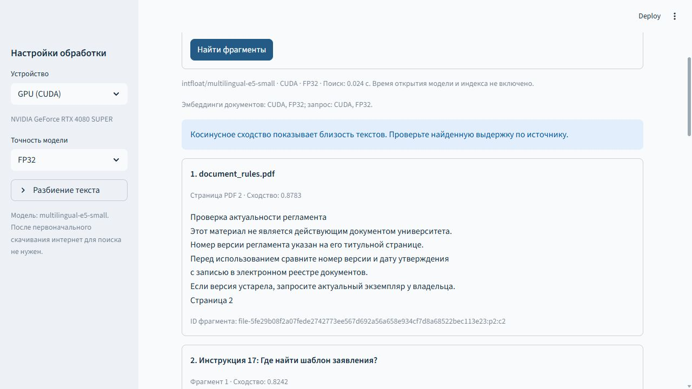

# Интеллектуальный навигатор по документам университета

Учебное приложение для поиска по документам на русском языке. Пользователь загружает файлы, строит индекс и задаёт вопрос. Программа находит до пяти подходящих фрагментов и показывает документ и страницу либо номер фрагмента.

**Тема практики:** «Разработка приложения семантического поиска по документам университета и оптимизация его нейросетевого модуля на GPU».

Проект продолжает летнюю работу: сохранены модули и тесты прежнего приложения, переработаны поиск и интерфейс, добавлена обработка документов. Новая версия находится в `app/`. Неизменённые летние исходники сохранены в архиве [synergy-ai-assistant.zip](legacy-source/synergy-ai-assistant.zip).

**Навигация:** [установка Windows](app/INSTALL.md) · [структура проекта](docs/STRUCTURE.md) · [проверка комплекта](docs/PACKAGE_CHECK.md) · [результаты тестов с GPU](docs/release-check-20261017.md).

## Интерфейс



Интерфейс состоит из вкладок **«Документы»**, **«Поиск»** и **«Эксперименты»**. На скриншоте показан поиск по учебным документам.

## Возможности

- Загрузка TXT, DOCX и PDF с текстовым слоем.
- Импорт 32 демонстрационных инструкций летнего проекта с ответами, шагами и источниками.
- Разбиение текста на фрагменты и локальный поиск с помощью E5.
- Сохранение индекса и повторное открытие без пересчёта документов.
- Выбор CUDA или CPU, FP32 или FP16 для CUDA.
- Измерения с прогревом и повторами, графики времени, памяти и качества, экспорт CSV.

После установки зависимостей и первоначального скачивания модели поиск работает локально. Программа возвращает исходные выдержки; генерации ответов LLM и распознавания сканов OCR нет. Демонстрационные инструкции не являются официальными документами университета.

## Установка и запуск

Проверенная среда: **Windows 11, Python 3.12 x64, RTX 4080 SUPER, PyTorch 2.8.0+cu128**. Нужен совместимый драйвер NVIDIA. Для первой установки требуется интернет; предусмотрите около 10–15 ГБ свободного места.

1. Скачайте проект через **Code → Download ZIP** и распакуйте архив.
2. Установите Python 3.12 x64. Откройте PowerShell в папке с этим README.
3. Выполните установку, указав фактический путь к Python 3.12:

```powershell
powershell -NoProfile -ExecutionPolicy Bypass -File .\app\setup.ps1 -Python "C:\путь\к\Python312\python.exe"
```

Если команда `python --version` уже показывает Python 3.12, можно запустить `app\setup.bat`.

4. Запустите `app\run.bat`. Адрес интерфейса: http://127.0.0.1:8501. Остановить приложение можно сочетанием Ctrl+C в окне запуска.

На компьютере без NVIDIA установите CPU-вариант, добавив к команде установки `-Cpu`, и выберите CPU в интерфейсе. Он подходит для проверки функций; его измерения не считаются GPU-экспериментом. Подробные команды и решение ошибок приведены в [руководстве](app/INSTALL.md).

## Быстрая проверка поиска

1. На вкладке «Документы» импортируйте 32 демоинструкции.
2. Добавьте `library.txt`, `practice.docx` и `document_rules.pdf` из `app/examples/`.
3. Нажмите «Построить и сохранить индекс».
4. На вкладке «Поиск» введите: **«Как проверить номер версии регламента?»**
5. Проверьте наличие результата из `document_rules.pdf`, страница 2.
6. Перезапустите приложение и откройте сохранённый индекс.

При первом запуске рабочая база и индекс создаются в `app/data/`. Эта папка и скачанные веса модели исключены из репозитория.

## Проверенные результаты

Базовый GPU-эксперимент выполнен **12 сентября 2026 года**: E5, CUDA, FP32, пакет 32, 35 документов и 36 фрагментов, один прогрев и три повтора.

| Показатель | Результат |
|---|---:|
| Полное время построения индекса, медиана | 56,4 мс |
| Кодирование фрагментов, медиана | 39,3 мс |
| Скорость стадии кодирования | 916,9 фрагмента/с |
| Пик allocated / reserved PyTorch | 588,45 / 646,00 МиБ |
| Hit@5 на демонстрационной выборке | 32 из 32 в каждом повторе |

Время включает чтение извлечённых текстов из SQLite, разбиение, кодирование и запись индекса. Первичное извлечение файлов и загрузка модели исключены. [Исходные повторы](docs/validation/20260912T071518Z-c2e4184a/runs.csv), [качество по вопросам](docs/validation/20260912T071518Z-c2e4184a/quality.csv), [сводка](docs/validation/20260912T071518Z-c2e4184a/summary.csv).

**Статус:** базовая версия готова. Полное сравнение пакетов 8/16/32/64/128 в FP32 и FP16, профилирование и выбор оптимизированной конфигурации ещё не выполнены. Ускорение относительно базового режима пока не установлено. Hit@5 относится к небольшой учебной выборке.

## Структура

```text
app/             рабочая версия: интерфейс, модули, тесты, примеры
legacy-source/   ZIP с неизменённым снимком летнего приложения
docs/            структура, результаты проверок и измерений
scripts/         проверка целостности исходников и комплекта
FILES.sha256     контрольные суммы переданных файлов
```

## Тестирование

17 октября 2026 года прошли 40 тестов рабочей версии с настоящей E5/CUDA и отдельно 8 тестов летнего снимка. В число 40 входят сохранённые летние проверки. [Журнал проверки](docs/release-check-20261017.md).

Из корня проекта после установки:

```powershell
.\.venv\Scripts\python.exe scripts/verify_package.py
.\.venv\Scripts\python.exe scripts/check_sources.py
cd app
..\.venv\Scripts\python.exe -m pytest -q
```

Для включения проверок настоящей модели на GPU:

```powershell
$env:NAVIGATOR_REAL_GPU = '1'
..\.venv\Scripts\python.exe -m pytest -q
```

Без этой переменной два теста с E5/CUDA пропускаются. Модульные тесты с заглушками не используются как результаты измерения производительности.

## Документация

- [Руководство пользователя](app/docs/USER_MANUAL.md)
- [Архитектура](app/docs/ARCHITECTURE.md)
- [Использование летнего кода](app/docs/MIGRATION.md)
- [Методика экспериментов](app/docs/EXPERIMENTS.md)
- [Проверки первого этапа](docs/stage1-validation.md)

Отчёт по практике и личные документы передаются отдельно от репозитория.
